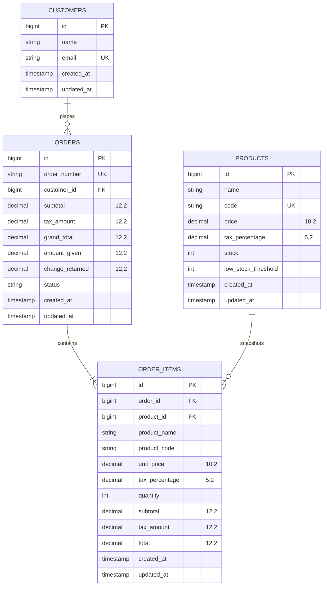

# Store Order & Inventory Mini-System
### Laravel Take-Home Assignment — Mallow Technologies

A high-performance, concurrency-safe retail billing and inventory management application built with **Laravel 11**, **MySQL (InnoDB)**, and **Alpine.js**.

---

## 📋 Table of Contents
1. [Overview & Scope](#overview--scope)
2. [Architectural Highlights (Senior Considerations)](#architectural-highlights-senior-considerations)
3. [Database Schema & ER Diagram](#database-schema--er-diagram)
4. [Concurrency Safety & Race Condition Prevention](#concurrency-safety--race-condition-prevention)
5. [Queued Job & Async Email Simulation](#queued-job--async-email-simulation)
6. [API Documentation](#api-documentation)
7. [Installation & Setup Guide](#installation--setup-guide)
8. [Testing & Edge Cases](#testing--edge-cases)
9. [UI Walkthrough (POS Screen & Wireframe Implementation)](#ui-walkthrough-pos-screen--wireframe-implementation)
10. [Assumptions & Design Decisions](#assumptions--design-decisions)
11. [Prompt Log](#prompt-log)

---

## 1. Overview & Scope
This system enables a retail counter clerk to record customer orders against a dynamic product catalog, sync inventory in real time, and automatically notify customers while strictly preventing overselling.

### Core Capabilities:
- **Products**: Name, unique code (SKU), unit price, tax percentage, stock on hand, and customizable low-stock threshold.
- **Customers**: Name, unique email, automated lookup during billing.
- **Orders & Invoices**: Subtotal, line-item tax calculation, aggregate tax, grand total, cash tendered, and change denomination breakdown.
- **Concurrency Safety**: Pessimistic row locking (`SELECT ... FOR UPDATE`) with deadlock-free lock sorting.
- **Asynchronous Processing**: Background queued job (`SendOrderConfirmationEmailJob`) on order placement.
- **POS Counter UI**: Matches the provided wireframe, complete with instant customer auto-fill, live calculations, low-stock alerts, and printable invoices.

---

## 2. Architectural Highlights (Senior Considerations)

- **Thin Controllers, Rich Domain Services**:
  - `OrderController`: Handles HTTP requests, passes validated data to `OrderService`, and formats responses via `OrderResource`.
  - `OrderService`: Encapsulates transaction management, customer resolution, ID sorting for deadlock prevention, pessimistic row locking, stock validation, itemized tax computations, atomic stock deduction, and queue event dispatching.
  - `InventoryService`: Manages catalog availability queries and low-stock threshold evaluations.
- **Immutable Historical Snapshots**:
  - In `order_items`, `unit_price`, `tax_percentage`, `product_name`, and `product_code` are frozen at order creation time. If a product's price or tax changes tomorrow, historical tax receipts remain 100% legally and mathematically accurate.
- **Strict Validation**:
  - Custom `CreateOrderRequest` accepts both nested objects (`customer: {name, email}`) and flat fields (`customer_name`, `customer_email`), enforcing RFC email validation, positive stock counts, and catalog integrity.
- **Graceful Error Handling**:
  - Custom `InsufficientStockException` returns clean, informative `422 Unprocessable Entity` JSON payloads detailing requested vs. available quantities.

---

## 3. Database Schema & ER Diagram

### Normalized Schema Overview:
- `customers`: `id`, `name`, `email` (unique index), `created_at`, `updated_at`.
- `products`: `id`, `name`, `code` (unique index), `price` (decimal 10,2), `tax_percentage` (decimal 5,2), `stock` (unsigned int, indexed), `low_stock_threshold` (unsigned int nullable), `created_at`, `updated_at`.
- `orders`: `id`, `order_number` (unique index), `customer_id` (FK to customers), `subtotal` (decimal 12,2), `tax_amount` (decimal 12,2), `grand_total` (decimal 12,2), `amount_given` (decimal 12,2 nullable), `change_returned` (decimal 12,2 nullable), `status`, `created_at`, `updated_at`.
- `order_items`: `id`, `order_id` (FK cascade), `product_id` (FK null on delete), `product_name`, `product_code`, `unit_price` (decimal 10,2), `tax_percentage` (decimal 5,2), `quantity` (unsigned int), `subtotal` (decimal 12,2), `tax_amount` (decimal 12,2), `total` (decimal 12,2), `created_at`, `updated_at`.
- `jobs`: Standard database queue driver table for async background tasks.

### Entity-Relationship Diagram:



---

## 4. Concurrency Safety & Race Condition Prevention

### The Problem
If two counter orders request the last remaining unit (`stock = 1`) simultaneously:
1. Standard non-locking `SELECT stock` would return `1` for both requests.
2. Both requests validate stock as available.
3. Both requests decrement stock by 1, driving inventory to `-1` (overselling).

### The Solution: Pessimistic Locking + Deadlock Prevention
1. **Sorted Lock Acquisition**:
   To prevent circular waiting deadlocks (e.g., Transaction 1 locks Product A and waits for B, while Transaction 2 locks Product B and waits for A), `OrderService` sorts all distinct product IDs in **ascending numerical order** before requesting locks:
   ```php
   $productIds = array_keys($consolidatedItems);
   sort($productIds);
   ```
2. **Pessimistic Row Lock (`SELECT ... FOR UPDATE`)**:
   Inside an atomic database transaction (`DB::transaction`), locks are acquired immediately:
   ```php
   $products = Product::whereIn('id', $productIds)
       ->lockForUpdate()
       ->get()
       ->keyBy('id');
   ```
3. **In-Lock Stock Verification**:
   The stock check is evaluated on the latest committed state holding the lock:
   ```php
   if ($product->stock < $requiredQuantity) {
       throw new InsufficientStockException($product, $requiredQuantity, $product->stock);
   }
   $product->decrement('stock', $requiredQuantity);
   ```
4. **Result**:
   When Request 1 locks the row, Request 2 waits. Request 1 decrements stock to 0 and commits. Request 2 resumes, reads `stock = 0`, throws `InsufficientStockException`, immediately aborts, rolls back, and returns `HTTP 422`. Stock never goes below 0.

---

## 5. Queued Job & Async Email Simulation

- **Class**: `App\Jobs\SendOrderConfirmationEmailJob` (`implements ShouldQueue`).
- **Dispatch**: Registered to trigger safely via `DB::afterCommit(...)` so failed transactions never send phantom order emails.
- **Execution**:
  - Driver: `database` (`jobs` table).
  - Simulates sending a complete confirmation email with customer details, order number, line items, and grand totals to `storage/logs/laravel.log`.
  - Automatic retries: `$tries = 3`.

To run the queue worker:
```bash
php artisan queue:work
```

---

## 6. API Documentation

### 1. Create an Order
- **Endpoint**: `POST /api/orders`
- **Headers**: `Content-Type: application/json`, `Accept: application/json`
- **Payload**:
```json
{
  "customer": {
    "name": "Thomas Alva",
    "email": "thomas@example.com"
  },
  "items": [
    { "product_id": 1, "quantity": 2 },
    { "product_id": 2, "quantity": 5 }
  ],
  "amount_given": 250.00
}
```
- **Response (201 Created)**:
```json
{
  "data": {
    "id": 1,
    "order_number": "ORD-20261029-XXXXXX",
    "customer": {
      "id": 1,
      "name": "Thomas Alva",
      "email": "thomas@example.com"
    },
    "subtotal": 150.00,
    "tax_amount": 12.00,
    "grand_total": 162.00,
    "amount_given": 250.00,
    "change_returned": 88.00,
    "status": "completed",
    "items": [
      {
        "id": 1,
        "product_id": 1,
        "product_name": "Colgate Toothpaste",
        "product_code": "TOOTH-001",
        "unit_price": 50.00,
        "tax_percentage": 8.00,
        "quantity": 2,
        "subtotal": 100.00,
        "tax_amount": 8.00,
        "total": 108.00
      }
    ],
    "created_at": "2026-10-29T06:40:00+00:00"
  }
}
```
- **Error Response (422 Unprocessable Entity - Insufficient Stock)**:
```json
{
  "message": "Insufficient stock for product 'Bread' (Code: BAK-001). Available: 4, Requested: 10.",
  "errors": {
    "stock": ["Product 'Bread' does not have enough stock."]
  },
  "product_id": 3,
  "product_name": "Bread",
  "product_code": "BAK-001",
  "available_stock": 4,
  "requested_quantity": 10
}
```

---

### 2. Fetch Customer Order History by Email
- **Endpoint**: `GET /api/customers/{email}/orders` (also supports `GET /api/customers/orders?email={email}`)
- **Response (200 OK)**:
```json
{
  "customer": {
    "id": 1,
    "name": "Thomas Alva",
    "email": "thomas@example.com"
  },
  "orders": [
    {
      "id": 1,
      "order_number": "ORD-20261029-XXXXXX",
      "subtotal": 150.00,
      "tax_amount": 12.00,
      "grand_total": 162.00,
      "status": "completed",
      "items": [...]
    }
  ]
}
```

---

### 3. Fetch Low-Stock Products
- **Endpoint**: `GET /api/products/low-stock?threshold=5`
- **Config**: Default threshold configurable in `config/inventory.php` (`INVENTORY_LOW_STOCK_THRESHOLD=5`).
- **Response (200 OK)**:
```json
{
  "effective_threshold": 5,
  "count": 3,
  "products": [
    {
      "id": 3,
      "name": "Bread",
      "code": "BAK-001",
      "price": 40.00,
      "tax_percentage": 5.00,
      "stock": 4,
      "low_stock_threshold": 5,
      "is_low_stock": true
    }
  ]
}
```

---

### 4. Create a Product
- **Endpoint**: `POST /api/products`
- **Headers**: `Content-Type: application/json`, `Accept: application/json`
- **Payload**:
```json
{
  "name": "Tata Salt 1kg",
  "code": "SALT-001",
  "price": 28.00,
  "tax_percentage": 5.00,
  "stock": 50,
  "low_stock_threshold": 10
}
```
- **Response (201 Created)**: Returns the newly created product resource.

---

### 5. Update a Product (with Duplicate SKU Protection)
- **Endpoint**: `PUT /api/products/{id}`
- **Headers**: `Content-Type: application/json`, `Accept: application/json`
- **Payload**:
```json
{
  "name": "Colgate Toothpaste (150g)",
  "code": "TOOTH-001",
  "price": 55.00,
  "tax_percentage": 12.00,
  "stock": 40,
  "low_stock_threshold": 8
}
```
- **Duplicate SKU Check**: Enforced via `Rule::unique('products', 'code')->ignore($productId)`. Rejects collisions with an existing code from any other product with `422 Unprocessable Entity`.

---

### 6. Customer Lookup (POS Auto-fill)
- **Endpoint**: `GET /api/customers/lookup?email=thomas@example.com`
- **Response**: `{ "exists": true, "customer": { "id": 1, "name": "Thomas Alva", "email": "thomas@example.com" } }`

---

## 7. Installation & Setup Guide

### Prerequisites
- PHP >= 8.2 (with `pdo_mysql`, `curl`, `mbstring`, `zip`, `intl` enabled)
- MySQL / MariaDB (e.g. XAMPP)
- Composer

### Setup Steps
1. **Clone repository & navigate to directory**:
   ```bash
   cd c:\xampp\htdocs\interview-task
   ```

2. **Install PHP dependencies**:
   ```bash
   composer install
   ```

3. **Configure Environment (`.env`)**:
   Ensure `.env` contains:
   ```env
   DB_CONNECTION=mysql
   DB_HOST=127.0.0.1
   DB_PORT=3306
   DB_DATABASE=store_order_inventory
   DB_USERNAME=root
   DB_PASSWORD=
   DB_COLLATION=utf8mb4_unicode_ci

   QUEUE_CONNECTION=database
   MAIL_MAILER=log
   INVENTORY_LOW_STOCK_THRESHOLD=5
   ```

4. **Generate Application Key**:
   ```bash
   php artisan key:generate
   ```

5. **Run Migrations & Seed Sample Data**:
   ```bash
   php artisan migrate --seed
   ```
   *(Seeds products from the wireframe: Colgate Toothpaste, Parle-G Biscuit, Bread, Milk, Eggs, etc., and sample customers).*

6. **Serve the Application**:
   - Access directly through XAMPP Apache: `http://localhost/interview-task/public/`
   - Or start Laravel development server:
     ```bash
     php artisan serve
     ```
     Access at: `http://localhost:8000`

7. **Run Background Queue Worker**:
   ```bash
   php artisan queue:work
   ```

---

## 8. Testing & Edge Cases

The project features a comprehensive test suite written in PHPUnit, executing on a dedicated test database (`store_order_inventory_test`).

### Run the tests:
```bash
php artisan test
```

### Coverage Summary (23 Passed Tests, 140 Assertions):
1. **Order Creation Happy Path**: Validates line subtotals, tax calculation, stock deduction, order item recording, and queued email dispatching.
2. **Edge Case - Insufficient Stock**: Confirms clean `422` failure, validates stock remains untouched, no order created, and no email queued.
3. **Edge Case - Concurrency & Overselling**: Simulates two orders arriving for `stock = 1`; verifies exactly one succeeds and one fails cleanly, ensuring final stock never goes negative.
4. **Deadlock Prevention**: Confirms multiple product locks are acquired in sorted order without cycle deadlocks.
5. **Customer Reusability**: Confirms repeated orders under the same email reuse the existing customer record.
6. **Validation Edge Cases**: Rejects empty items, missing email, zero/negative quantity, and nonexistent product IDs.
7. **Customer Order History**: Validates retrieval via route parameter, query parameter, 404 for unknown email, and 422 for malformed email.
8. **Low-Stock Alerts**: Validates default threshold, query parameter overrides, and per-product threshold overrides.
9. **Product Creation**: Validates creation of catalog items and enforces code uniqueness and required fields.
10. **Product Update & Duplicate Protection**: Validates updating stock, price, and GST, confirms updating a product with its own code is permitted, and asserts changing code to another product's code is rejected with `422`.

---

## 9. UI Walkthrough (POS Screen & Wireframe Implementation)

The interface strictly reflects the wireframe provided in Page 2 of the PDF:
1. **Customer Section**: Entering `thomas@example.com` automatically looks up and fills "Thomas Alva".
2. **Products Table**: Allows choosing products from the live catalog, selecting quantities, and displays unit prices, tax percentages, and real-time line totals.
3. **Payment & Change Denominations**:
   - Live computes Subtotal, Tax, and Grand Total.
   - Enter tendered cash in "Amount Given by Customer" (e.g. ₹250).
   - "Balance to Return" calculates change along with an exact denomination breakdown (e.g. `₹88.00 -> 1x50 + 1x20 + 1x10 + 1x5 + 1x2 + 1x1`).
4. **Low Stock Alert Sidebar**: Displays products currently low in stock (e.g. Bread, Eggs, Milk) with an instant refresh button.
5. **Generate Bill Button**:
   - Posts order via API.
   - Automatically opens a printable Receipt Modal.
   - Triggers background email simulation and updates catalog stock on screen.
6. **Order History**: Click "Order History" in the top bar to inspect any customer's previous bills by email.

---

## 10. Assumptions & Design Decisions
1. **Tax Model**: Tax percentage is maintained per product (e.g. 0%, 5%, 8%, 18%) and calculated on the item subtotal (`quantity * unit_price * tax_percentage / 100`).
2. **Customer Identity**: Email is the primary unique identifier for customers. If an existing email is provided with a new name, the customer profile is updated and linked to the new order.
3. **Historical Snapshots**: Product catalog modifications should never retroactively change historical order numbers or invoices. Therefore, prices, names, and tax percentages are duplicated into `order_items`.
4. **Low Stock Threshold**: Can be configured globally via `config/inventory.php` / `.env` or overridden per query / per product.
5. **Simulated Email**: In accordance with Requirement 5, email dispatch is logged with full structured payload to `storage/logs/laravel.log` via the queued job.

---

## 11. Prompt Log
Full AI prompt log and developer instructions are preserved in `/prompts/prompt_log.md`.
